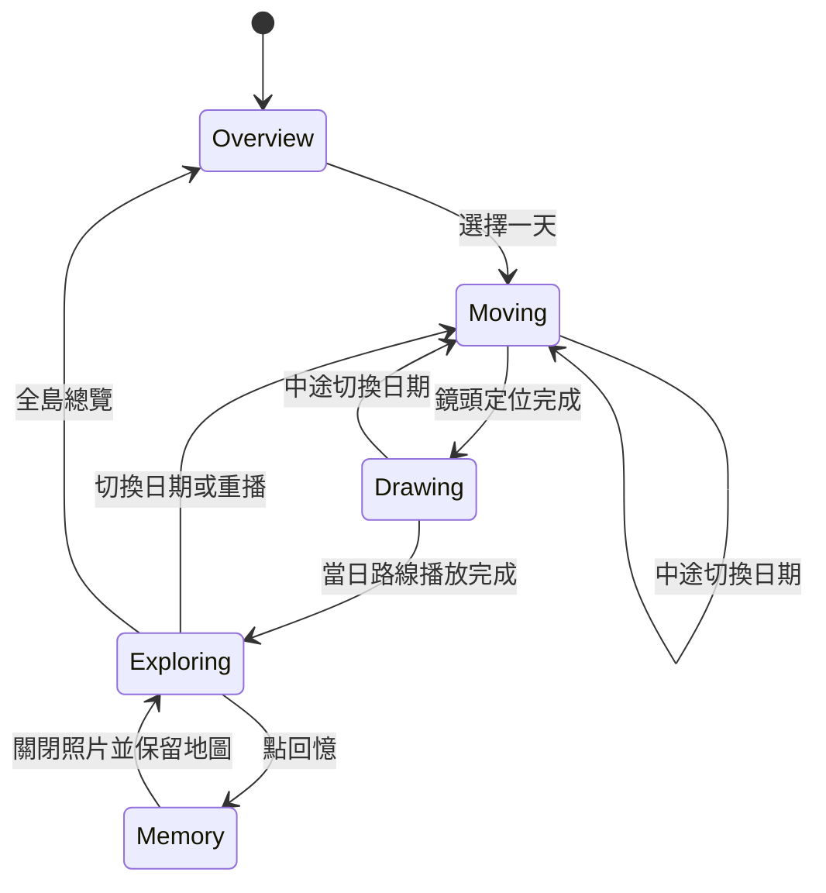

# 技術架構與實作規劃

正式功能與驗收條件以[冰島 18 天回憶網站與本機內容整理工具規格](../.scratch/memory-experience/spec.md)為準；本文件說明既有架構與規劃背景，規格發布不代表功能已完成。

目前技術實作已接入正式 A 觀看介面、本機內容編輯、批次圖片處理與靜態匯出；真實照片、精確位置與公開部署仍待完成。最新操作與交付狀態見[本機工具說明](local-editor.md)，以下保留架構背景。

## 產品基準

完整旅程為 2026/09/23–2026/10/10，共 18 天，包含去回程與轉機。每日真實內容及待確認位置以 [真實行程紀錄](itinerary.md) 為準；正式網站已載入 18 天、109 段真實文字回憶；歷史原型中的兩天仍為示範。已確認保留完整時間線，冰島以外的航程以故事卡呈現，地圖維持冰島視野。

2026-10-24 已確認：第一版沿用示意連線，每個實際行程項目皆可開啟回憶，照片可有一張或多張，使用者預計下週補齊。專案為一次性製作，上線後不規劃額外維護；內容管理改為本機工具，產出完整靜態網站，不建立線上內容後台。最新版 A 作為體驗基準，跨日重疊採「總覽選天，當天看回憶」預設方案，待真實資料驗證，見[決策地圖](../.scratch/memory-experience/map.md)。

網站分享你們自己的故事，公開內容只包含挑選過的照片。首頁與旅行日都以全螢幕冰島地圖為主，選單浮在地圖上，不以固定 header／footer 縮小視野。訪客選擇一天後，鏡頭與路線快速帶過，隨即停留探索，由訪客主動點選回憶或切換日期。

每個回憶點以第一張照片作為代表照片，再展開按順序排列的照片與文字。關閉照片保留原本地圖位置與路線。回憶可包含景點、餐廳、住宿與路邊趣事。第一版每個實際行程項目皆可開啟；缺照片仍能讀故事，缺座標則先由當日清單開啟，不猜測位置。

### 已確認的回憶體驗方向

- 以你與旅伴一起經歷的小故事為內容重心，讓風景帶出當時的感受。
- 回憶點以你們自己的「回憶名稱」為標題，搭配代表照片；正式地名提供位置線索。
- 精選照片組採一次看一張、完整呈現照片；以橫向滑動為主，桌機保留拖曳、觸控板與方向鍵／按鈕。需要時再展開說明。
- 相簿下方只保留同一列左右導覽與張數。中間張為上一張／下一張；第一張的左側可回上一段回憶的最後一張，最後一張的右側可進下一段的第一張。滑動維持在同一段內；最後一段的末張右側回到地圖。避免另加一整塊跨回憶按鈕或照片上方的上一段入口。
- 路線只作快速定位的過場，不再長時間逐站導覽。過場中點選回憶就完成路線並開啟照片故事；關閉後保留地圖位置，維持自由探索。
- 每個回憶點可有一段共同短文，特別的回憶可各自補上一句，保留兩個人的視角。
- 第一版先透過地圖與旅行日尋找回憶，暫緩跨越 18 天的照片與回憶名稱清單。
- 不自動逐站切換代表照片預覽；回憶點持續可點選，由觀看者自行挑選照片故事。
- 切換旅行日只保留短過場，原型 A 先試鏡頭 650 毫秒、路線 1850 毫秒；約 2.5 秒後自由探索。這是待體驗調整的參數，不是導覽播放時間。

### 核心觀看流程

1. 在全螢幕冰島地圖上，透過浮動選單或地圖入口選擇旅行日。
2. 鏡頭快速定位、帶出當日路線，保留所有回憶標記。
3. 自行點選任意回憶，打開可手動翻看的精選照片組；需要時展開共同短文與旅伴補充。
4. 最後一張照片維持停留；主動關閉後，回到原本地圖位置繼續探索。
5. 由觀看者決定下一個回憶或旅行日，不自動推進故事。

### 原型與最新回饋

- 使用者試看後偏好原本桌機的全幅地圖與浮動選單，認為固定 header／footer 壓縮視野，長路線動畫也不必要。
- 已據此修訂開發原型 A（`/?variant=A`）：全螢幕地圖、浮動控制、快速路線過場、主動點選照片故事。現有 Day 01 的 7 個與 Day 02 的 5 個回憶點，可用日期選單、前後箭頭及全島標記切換。B／C 保留為前一輪比較，不代表最新共識。
- 七個點在手機上需避免遮擋；原型以錯開標記並加位置連線試驗。鏡頭移動中清除舊連線，定位後才重新計算，避免短線隨縮放變成長線。
- 手機的圖資來源標示預設收合為資訊按鈕，可點開來源連結。依 [OpenFreeMap 官方 Attribution](https://openfreemap.org/#attribution)，OpenFreeMap 品牌可省略；原型已移除該品牌文字，保留 OpenMapTiles／OpenStreetMap 署名。
- 正式首頁已採 A 體驗；尚需用真實照片確認停留效果與載入品質。

## 已建立的基礎

| 層次       | 技術與職責                                                      |
| ---------- | --------------------------------------------------------------- |
| 畫面       | Vue 3、Composition API、TypeScript SFC，以功能分組              |
| 開發與建置 | Vite、vue-tsc，產出可靜態部署的 `dist/`                         |
| 地圖       | MapLibre GL JS，獨立 worker；OpenFreeMap Positron 作為初始底圖  |
| 動畫       | MapLibre `fitBounds` 與 `requestAnimationFrame`，沿座標逐步展開 |
| 狀態       | `useJourney` 持有日期、回憶、播放階段與重播序號                 |
| 內容       | 型別化的旅行日、回憶點與照片清單，目前使用本地示範資料          |
| 品質       | Vitest、Playwright、ESLint、Oxlint、Prettier                    |

單頁地圖先用 Vue composable 管理狀態。需要獨立頁面、可分享回憶網址時再加入 Vue Router；跨頁共享狀態變複雜後再評估 Pinia。

MapLibre 使用非同步元件載入，獨立程式區塊仍有地圖引擎本身的容量成本。底圖透過 `VITE_MAP_STYLE_URL` 設定，保留供應商替換空間與來源標示。OpenFreeMap 是外部服務，正式公開前應重新確認使用條款與可用性需求。

初始化直接以冰島總覽範圍建立鏡頭，避免先下載較廣視野的圖磚。平移限制在冰島及附近海域，最大縮放層級為 12，關閉世界重複顯示。樣式載入完成後即可建立回憶圖層與日期入口，底圖圖磚、字體在背景漸進載入；完整底圖的載入提示與錯誤處理分開保留。量測與取捨見 [初始化效能](performance.md)。

## 目錄

```text
src/
  App.vue                         # 組合地圖、導覽與照片故事
  composables/useJourney.ts       # 旅程選取與播放狀態
  data/journey.ts                 # 旅行內容入口
  features/
    journey/DayNavigator.vue      # 總覽、選日期、前後一天
    map/
      JourneyMap.vue              # 地圖建立、載入與銷毀
      mapScene.ts                # 圖層、標記、鏡頭與動畫取消
      route.ts                   # 路線距離與進度計算
      viewport.ts                # 冰島總覽範圍與版面留白
    memories/MemoryStory.vue      # 代表照片、排序照片與故事
  styles/main.css                 # 共用色彩與響應式排版
  types/journey.ts                # 內容契約
public/images/                    # 開發示範用圖片
e2e/                              # 桌面與手機瀏覽器測試
docs/                             # 架構說明
```

## 播放與互動狀態



切換日期時取消上一段動畫與事件監聽，避免舊路線繼續更新。元件卸載時移除動畫、標記、計時器與地圖實例。開啟照片不改變日期與重播序號，因此不觸發鏡頭重設。瀏覽器偏好減少動態效果時直接顯示完成狀態。

目前總覽提供可點選的每日標記；點一整個區域選日期及同區跨天的選擇清單，待真實路線確定後補上。

## 內容模型

`Journey → JourneyDay[] → TravelMemory[] → MemoryPhoto[]`

- 旅行日：獨立識別、顯示天數、可選日期、路線與回憶清單。
- 回憶：位置、標題、故事與照片，使用 `routeIndex` 指定沿路線亮起的位置。
- 座標一律 `[經度, 緯度]`；同一地點可在不同日出現，使用不同回憶識別即可。
- 照片：縮圖、瀏覽圖、尺寸、替代文字與可選說明；陣列順序就是敘事順序。
- `routeKind`：區分示意連線、實際記錄與道路匹配路線，避免把直線或估算道路當作真實軌跡。

正式觀看改從靜態內容清單讀取完整真實文字行程；舊的兩天示範資料僅保留供歷史骨架與既有測試參考。示範線段不代表實際駕車道路。真實內容沿用相同契約；路線資料較大時再拆成逐日載入的 GeoJSON。

## 照片處理規劃（已提供工具，待旅人補素材）

1. 在 Google 相簿挑選每段回憶的照片並決定順序，再下載選中的檔案。大量匯出可使用 Takeout，保留原檔與附帶 JSON。
2. 原始照片保留在私人收藏或備份，與公開網站分開管理，原始大檔不提交至 Git。
3. 本機產生縮圖與瀏覽圖。可先以縮圖長邊 480 px、瀏覽圖長邊 1920 px 測試，再用實際照片確認品質與容量。後續可用 Sharp 自動產生 WebP／AVIF，目前未安裝影像處理工具。
4. 檢查公開版本與說明，產生展示圖時移除不需要的 EXIF；網站需要的日期、位置明確記入內容清單。
5. 精選照片經本機工具處理後，與網站一起打包為靜態檔案部署；原檔與草稿保留本機，本次範圍不使用獨立物件儲存或圖片處理服務。
6. 代表照片在開啟回憶後載入，其餘照片展開後使用 lazy loading。地圖預覽縮圖、`srcset`、響應式尺寸與快取待真實照片接入時補齊。

Google 相簿作為選片來源。Library API 已限制為應用程式建立的內容，Picker API 照片網址有期限，因此不把相簿連結當作長期圖床，也不需要先同步近萬張私人照片。

## 視覺與操作基準

目前依使用者口述建立可操作骨架，尚無已確認的設計稿。以全幅地圖、米白與深綠配色為起點，日期導覽固定下方。桌面故事置左側，手機使用較小且可捲動的面板；照片使用原生 dialog，支援 Escape 與焦點約束。

正式設計需用真實照片驗證標記密度、代表照片如何浮現、手機面板高度、18 天導覽及同區多日的選擇方式。現在的手機面板並非最終底部抽屜設計。

## 後續實作順序

1. 以一個真實旅行日驗證回憶位置、選片順序與短文。
2. 第一版依行程順序建立示意連線並標示性質，不作道路匹配；將來取得軌跡或優化路線時再替換。
3. 完成精選照片轉檔、尺寸與清單流程，讓兩位旅人能持續補內容。
4. 擴充到 18 天，處理去回程旅行日、標記重疊、區域點選、手機手勢與圖片錯誤狀態。
5. 加入可分享的日期／回憶網址、分享預覽與靜態部署。若每段故事需要搜尋引擎索引，再評估預先產生頁面或 Nuxt。

### 本機內容整理與靜態匯出（已接入）

本次製作採「本機編輯 → 本機圖片處理 → 靜態成品預覽 → 匯出 → 部署」。建議用瀏覽器呈現本機編輯介面，搭配僅監聽 loopback 的本機服務，負責讀寫指定的內容目錄及執行圖片處理；公開網站無需此服務。

- 依旅行日與回憶點匯入照片、拖曳排序、指定代表照片、編輯共同短文與照片說明，支援單張或多張照片。
- 原檔獨立保存，產生網站用縮圖與瀏覽圖，處理方向與尺寸、移除展示檔不需要的中繼資料；實際格式與品質待真實素材驗證。
- 內容與照片關聯寫入本機內容檔，關閉工具後仍可恢復，不以瀏覽器儲存空間作為唯一資料來源。保留穩定的旅行日、回憶與照片識別。
- 匯出前檢查圖片參照、檔案數與大小、缺漏內容。缺照片與缺座標狀態明確呈現；未確認位置不產生虛構座標。
- 預覽以正式靜態成品驗證相對路徑與照片呈現；最後產出可部署的靜態目錄。編輯工具、寫檔服務、原檔與草稿均排除在部署輸出之外。
- 保留本機原檔、內容清單與最終靜態成品備份。完成後觀看網站不依賴本機工具運行，也不需要雲端內容 API、資料庫或帳號後台。

本機工具細節與實作任務仍待正式規格。本機瀏覽器操作為推薦方向，未承諾桌面應用程式包裝或自動部署功能。靜態網站目前仍使用外部底圖服務，不等同完全離線的旅程封存。

### Cloudflare 候選方向（尚未定案或部署）

使用者希望網站幾乎零成本、維持免費額度。2026-10-24 查核後，第一版優先建議把網站與處理後的精選圖片一起部署到 Workers Static Assets，使用免費 `workers.dev` 網址；照片由本機工具產生縮圖與瀏覽圖。本次範圍不需要 R2、Images、雲端資料庫或線上內容後台；若完成前修改內容，重新產生及部署靜態成品即可。

依 [Static Assets 計費](https://developers.cloudflare.com/workers/static-assets/billing-and-limitations/)，靜態檔案儲存無額外費用、靜態請求免費且不限次數；[免費方案限制](https://developers.cloudflare.com/workers/platform/limits/#static-assets) 為每版本 20,000 個檔案、單檔 25 MiB。這與 Worker 動態程式請求額度不同，第一版應直接由靜態資產處理觀看請求。`workers.dev` 官方定位包含[個人與興趣專案](https://developers.cloudflare.com/workers/configuration/routing/workers-dev/)。以上為查核日規則，部署前重新確認。

先前提出的雲端媒體儲存、動態圖片處理與資料庫候選，已由一次性製作與本機工具方向取代。部署時只提供靜態網頁、內容資料及精選圖片。

## 驗證方式

單元測試涵蓋日期／回憶切換、關閉照片保留狀態、按距離畫路線與邊界情況。瀏覽器測試涵蓋桌面與手機的路線亮起、手動切換、快速切換取消、照片展開與關閉、減少動態效果。

自動測試以簡單底圖隔離外部圖資服務，保留真實 MapLibre WebGL 與動畫；真實外部底圖另行確認。公開前還需以真實照片與路線檢查手機效能、圖片容量、網路錯誤與鍵盤操作。

## 官方參考

- [Vue Quick Start](https://vuejs.org/guide/quick-start.html)
- [MapLibre 路線動畫範例](https://maplibre.org/maplibre-gl-js/docs/examples/animate-a-line/)
- [OpenFreeMap Quick Start](https://openfreemap.org/quick_start/)
- [Google Photos API 更新](https://developers.google.com/photos/support/updates)
- [Google Photos Picker 網址期限](https://developers.google.com/photos/picker/guides/media-items)
- [Google 資料匯出與中繼資料](https://support.google.com/photos/answer/3024190?hl=zh-Hant)

## 相簿閱讀與關閉

相簿外框固定，內容在內部捲動。外框大小依當天有沒有照片決定：有照片的旅行日使用高外框，全部沒有照片的旅行日使用較小的文字外框，同一天內切換回憶時按鈕位置不變。標題、關閉按鈕與回憶切換固定。故事直接顯示，不需要開關；有照片時接在照片組下方，沒有照片時放大成主要內容。開啟時焦點落在標題；用切換按鈕換回憶時，焦點留在同一顆按鈕。滾動條預留空間，避免內容變動時寬度改變。

照片故事的關閉按鈕使用「×」，輔助標籤為「關閉照片故事」。相簿終點的文字按鈕使用「關閉」。

## 回憶點辨識與操作層級

- 標記平時顯示序號與地名，有代表照片時加上縮圖；序號與回憶清單一致。點擊直接開啟照片故事，桌機與手機相同。
- 標記優先留在實際位置，空間不足時就近錯開並以連線指回原位；放不下或會離原位太遠（超過視窗短邊的 30%）時，只顯示序號，避免互相蓋住而點不到。鏡頭移動期間仍清除位置連線。
- 有回憶不在地圖上時，當日資訊提供開啟清單的操作並寫明段數。
- 相簿沿用單列導覽，翻照片用淺色描邊圓角按鈕與單箭頭；換回憶用深綠實心、較方的按鈕、雙箭頭與完整文字，讓區分同時依靠顏色、形狀及標籤。
